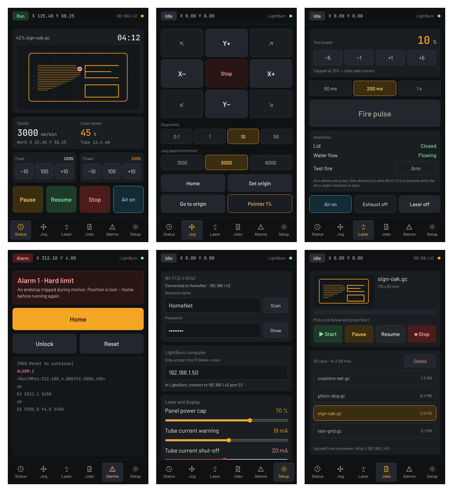
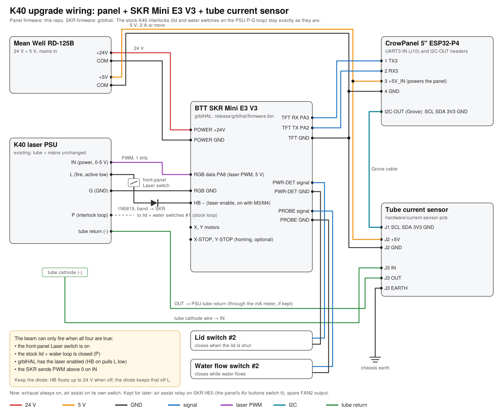
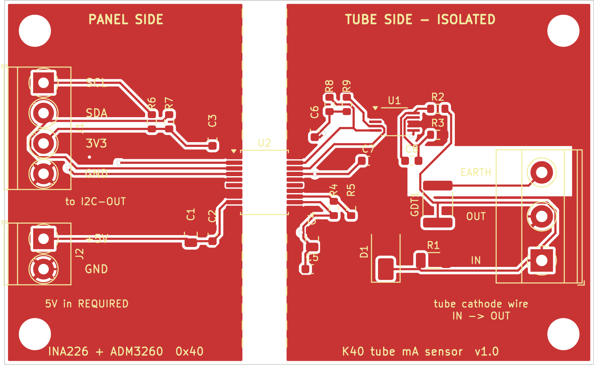

# K40 laser panel

A touchscreen control panel and controller upgrade for the K40 CO₂ laser. A 5" ESP32-P4 touchscreen
sits on the front of the machine. The K40 runs **grblHAL** on a BTT SKR board, and **LightBurn streams
over Wi-Fi** through the panel, so no USB cable runs to the PC.

```
LightBurn ──Wi-Fi──► 5" panel (ESP32-P4) ──serial──► BTT SKR (grblHAL) ──► K40 motors + laser PSU
                      ▲ touch: status, pause/stop, overrides, jog, test fire, tube current
```

> [!WARNING]
> **Early release.** The firmware compiles, but it's being tested on its first machine now. Check each
> step against your own K40, and do the first tests with the K40's **Laser** switch off.
>
> A K40 runs at around 20 kV and can start fires. Unplug it and wait before working inside, never
> defeat the lid or water interlocks, and never leave it running unattended.



*Screen designs: Status, Jog, Laser, Alarms, Setup and Jobs. The Jobs screen and the job preview
on Status are in the [beta branch](#beta-run-jobs-from-the-panel).*

## What it does

- **Status at a glance:** state, position, speed, laser power, live tube current (mA), job time.
- **Control from the machine:** pause, resume, stop, feed and power overrides, air assist, jog,
  home, set origin, timed test fire, low-power pointer.
- **Shares control with LightBurn:** the panel's buttons work mid-job without corrupting LightBurn's
  stream.
- **Safety:**
  - Lid and water status (optional second switches).
  - A software power cap, and an automatic shut-off if tube current goes over a limit (optional
    sensor).
  - PIN lock for Setup and test fire.
- **Easy to set up and update:** Wi-Fi, LightBurn PC and limits are set on the touchscreen.
  Firmware updates go on from a microSD card.
- **Plain-English alarms**, laser on-time (tube hours) and screen sleep.

## Hardware

| Part | Where | Notes |
|---|---|---|
| Elecrow CrowPanel Advanced 5" **ESP32-P4** (800×480, without camera) | [Amazon](https://www.amazon.com/dp/B0GLGWJP8B) | Used in portrait. Wi-Fi via its on-board ESP32-C6. Get the **P4** model, not the ESP32-S3 "Advance" |
| BTT **SKR Mini E3 V3** | [Amazon](https://www.amazon.com/dp/B0DFH6HDJ4) | Runs grblHAL. Its TMC2209 drivers run the K40's steppers |
| *or* BTT **SKR 3** with TMC2209 drivers | [Amazon](https://www.amazon.com/dp/B0CD7SFRGC) | Ships with an STM32H723 or H743 chip. This repo's build is for the **H723**, so check the chip |
| Mean Well **RD-125B** (24 V + 5 V) | [Amazon](https://www.amazon.com/dp/B005T9JN6E) | 24 V for the SKR, 5 V for the panel |
| 1N5819 diode | [Amazon](https://www.amazon.com/dp/B079KG1TN2) | Laser enable, see [wiring](docs/wiring.md#laser-psu) |
| JST-XH 2.54 mm kit with pre-crimped leads | [Amazon](https://www.amazon.com/dp/B08G17QHSD) | Panel UART3-IN plug (4-pin) |
| *Optional:* second lid switch, second water-flow switch | | Lid and water status on the panel |
| *Optional:* [tube current sensor](hardware/current-sensor-pcb/README.md) + [Grove cable](https://www.amazon.com/dp/B01CNZ9RJO) | | Live mA readout and over-current shut-off |

Listings change, so check the model before buying. These aren't affiliate links.

## Getting started

1. **Wire it:** [docs/wiring.md](docs/wiring.md) has the full diagram plus the laser PSU, lid and water details.
2. **Flash the SKR and the panel:** [docs/install.md](docs/install.md). Both are ready-made files.
   The SKR flashes straight from a microSD card. The panel needs one install over USB from your
   browser, then updates from a microSD card too.
3. **Power up and check the link:** the panel's header should show *Idle*.
4. **Set it up on the touchscreen:** Wi-Fi, your LightBurn PC's IP and the power limits.
   See [docs/using.md](docs/using.md).
5. **Connect LightBurn** as a GRBL device over the network: the panel's IP, port 23.

Something not working? Check [docs/troubleshooting.md](docs/troubleshooting.md).



## Tube current sensor (optional)

An isolated INA226 board goes in series with the tube's return wire and plugs into the panel's I2C
port. You get the real tube current on screen, a warning above one limit, and an automatic laser
shut-off above another (20 mA by default).
- [Single-board PCB](hardware/current-sensor-pcb/README.md): Gerbers, BOM and placement files for
  JLCPCB assembly, plus a Digi-Key BOM for building it yourself.
- [Two-module version](docs/tube-current-sensor.md): built from off-the-shelf breakout boards.



## Beta: run jobs from the panel

The [`feature/sd-jobs`](https://github.com/MikonosII/k40-laser-panel/tree/feature/sd-jobs) branch adds:
- **Panel jobs:** upload G-code from a browser (LightBurn's *Save GCode*), store it on the panel's SD
  card, and run it from a new **Jobs** screen. A Wi-Fi drop or a sleeping PC can't interrupt the job.
- **Preview:** a picture of the job's laser path with the head's live position.
- **History:** the last 20 jobs, with time, run time and peak tube current.

It merges into `main` once it's been tested on a machine.

## Repository layout

| Path | What |
|---|---|
| `main/` | Panel firmware (ESP-IDF 5.5, C++, LVGL 9) |
| `release/` | Ready-made panel images (`firmware.bin` for SD updates, `k40-panel-full-*.bin` for the first USB install) and grblHAL builds |
| `grblhal/` | grblHAL build for the SKR Mini E3 V3 (and `skr3/` for the SKR 3), with settings and source build scripts |
| `hardware/current-sensor-pcb/` | KiCad board, fab files, BOMs, printed enclosure |
| `hardware/lid-stay/` | Printed lid stay that holds the lid at a set angle, for a LightBurn camera |
| `docs/` | Wiring, install, usage, troubleshooting, current sensor |

## Credits and license

Built on [grblHAL](https://github.com/grblHAL) (including the community
[STM32G0xx](https://github.com/mtaylor819/STM32G0xx) and [STM32H7xx](https://github.com/dresco/STM32H7xx)
drivers), [LVGL](https://lvgl.io), Espressif's [ESP-IDF](https://github.com/espressif/esp-idf) and
[esp_hosted](https://github.com/espressif/esp-hosted-mcu), and Elecrow's board examples.

- Panel firmware and docs: **MIT** ([LICENSE](LICENSE))
- Current sensor PCB: **CERN-OHL-P-2.0** ([LICENSE](hardware/current-sensor-pcb/LICENSE))
- grblHAL builds: **GPL-3.0**, like grblHAL itself ([COPYING](grblhal/COPYING))

No warranty. You are responsible for your own machine and safety.
