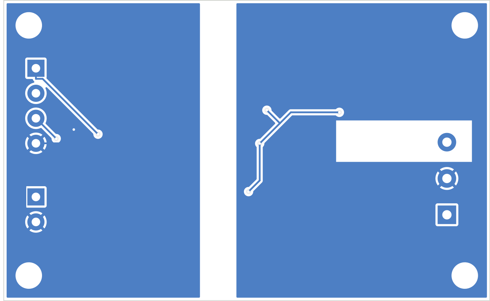

# Tube current sensor PCB

One small board that replaces the two-module build in
[docs/tube-current-sensor.md](../../docs/tube-current-sensor.md). It does the same job with the
same chips (INA226 + ADM3260) and needs no firmware changes: the panel finds it at address 0x40.

- 68 × 42 mm, 2 layers, 1.6 mm, four M3 holes (3.2 mm)
- All SMT parts on the top, sized for JLCPCB assembly
- 3 screw terminals (through-hole) you solder yourself
- 5.1 mm copper-free isolation gap between the panel side and the tube side

| Top | Bottom |
|---|---|
|  |  |

## Connections

| Terminal | Pin | Goes to |
|---|---|---|
| **J1** (3.5 mm, 4-pin) | SCL, SDA, 3V3, GND | Panel **I2C-OUT** (Grove cable, cut one end; red = 3V3, black = GND, yellow = SCL, white = SDA) |
| **J2** (3.5 mm, 2-pin) | +5V, GND | The 5 V supply (same 5 V that feeds the panel's UART3-IN pin 3) |
| **J3** (5.08 mm, 3-pin) | IN, OUT, EARTH | Tube cathode wire **IN → OUT**; EARTH to the chassis earth screw |

**J2 must have 5 V.** The isolated side runs at 5 V so the INA226 reads the ADM3260's logic
levels reliably, and the ADM3260 can only make 5 V from a 5 V input.

## Circuit

```
 Panel side                         |  barrier  |   Tube side (isolated)
                                    |           |
 J1 SCL ──┬─ R6 4.7k ─ 3V3          |   U2      |          VISO (5 V)
 J1 SDA ──┼─ R7 4.7k ─ 3V3          | ADM3260   |   R8/R9 4.7k pull-ups to VISO
          └── SCL2/SDA2 ────────────┤ I2C + DC/DC├── SCL1/SDA1 ─── U1 INA226 (0x40)
 J1 3V3 ── VDDP (C3 100n)           |           |   VISO ── U1 VS (C7 100n)
 J2 +5V ── VIN  (C1 10u, C2 100n)   |           |   VISO (C4 10u, C5 100n), VDDISO (C6 100n)
 PDIS ── GND (converter on)         |           |   VSEL: R4 30k / R5 10k  → 4.9 V
                                    |           |
                                    |           |   J3 IN ─┬─ R1 0.1 Ω ─┬─ J3 OUT (= isolated GND)
                                    |           |          ├ D1 SMAJ5.0CA ┤
                                    |           |          ├ R2 10 Ω ─ IN+ ┐ C8 100n
                                    |           |          │      R3 10 Ω ─ IN− ┘
                                    |           |          └ GDT1 200 V ── J3 EARTH
```

Full netlist (checked against the board file):

| Net | Pins |
|---|---|
| +3V3 | J1.3, U2.4 VDDP, C3, R6, R7 |
| +5V | J2.1, U2.9 VIN, C1, C2 |
| GND | J1.4, J2.2, U2.1/5/7/10, U2.8 PDIS, C1, C2, C3 |
| SCL_P / SDA_P | J1.1 / J1.2, U2.2 SCL2 / U2.3 SDA2, R6 / R7 |
| VISO | U2.12 VISO, U2.17 VDDISO, U1.6 VS, C4–C7, R4, R8, R9 |
| VSEL | U2.13, R4/R5 junction |
| SCL_I / SDA_I | U2.19 SCL1 / U2.18 SDA1, U1.5 / U1.4, R8 / R9 |
| GNDISO | J3.2 OUT, U2.11/14/16/20, U1.1 A1, U1.2 A0, U1.7 GND, U1.8 VBUS, R1, R3, R5, D1, C4–C7 |
| TUBE_IN | J3.1 IN, R1, R2, D1, GDT1 |
| INP_F / INN_F | U1.10 IN+ / U1.9 IN−, R2 / R3, C8 |
| EARTH | J3.3, GDT1 |

## Ordering from JLCPCB

1. Go to jlcpcb.com → **Order now** → upload **`fab/k40-current-sensor-gerbers.zip`**.
   Defaults are fine: 2 layers, 1.6 mm, any color, HASL lead-free (or ENIG).
2. Turn on **PCB Assembly**: Economic, **Top side**, quantity 2 or 5.
3. Upload **`fab/k40-current-sensor-bom.csv`** and **`fab/k40-current-sensor-cpl.csv`**.
4. On the parts page, confirm every line matched. **Check stock for U2 (ADM3260, C208558).** It's
   the scarce, pricey part (about $15). If JLC is out, choose **Global Sourcing** or pre-order
   it into your JLC parts library.
5. On the placement preview, check the **pin-1 dots on U1 and U2** line up with the dot on the
   silkscreen. Rotate a part in the preview if JLC's footprint lands off by 90° or 180°.
6. Order. Expect roughly $50–70 before shipping for 5 bare boards with 2 assembled. Most of that
   is the two ADM3260s and JLC's $3-per-line fee for extended parts.

**OSH Park** also takes the same Gerber zip, but it doesn't assemble. You'd hand-solder the
SSOP-20 and the 0.5 mm-pitch VSSOP-10 yourself.

### Parts you solder yourself (not in the JLC BOM)

| Ref | Part | Phoenix # |
|---|---|---|
| J1 | Screw terminal, 4-pos, 3.5 mm | [PT 1,5/4-3,5-H 1984633](https://www.digikey.com/en/products/result?keywords=1984633) |
| J2 | Screw terminal, 2-pos, 3.5 mm | [PT 1,5/2-3,5-H 1984617](https://www.digikey.com/en/products/result?keywords=1984617) |
| J3 | Screw terminal, 3-pos, 5.08 mm | [MKDS 1,5/3-5,08 1715734](https://www.digikey.com/en/products/result?keywords=1715734) |
| – | Grove 4-pin cable (cut one end) to panel I2C-OUT | as in the module BOM |
| – | 4 × M3 **nylon** standoffs and screws | keeps the isolated side off the chassis |

## Assembled BOM (JLC)

| Ref | Value | Package | LCSC |
|---|---|---|---|
| U1 | INA226AIDGSR | VSSOP-10 | C49851 |
| U2 | ADM3260ARSZ | SSOP-20 | C208558 |
| R1 | 0.1 Ω 1 % 1 W (FOJAN FRM121WFR100TM) | 1206 | C7467250 |
| R2, R3 | 10 Ω | 0603 | C22859 |
| R4 | 30 kΩ | 0603 | C22984 |
| R5 | 10 kΩ | 0603 | C25804 |
| R6–R9 | 4.7 kΩ | 0603 | C23162 |
| C1, C4 | 10 µF 25 V | 0805 | C15850 |
| C2, C3, C5–C8 | 100 nF | 0603 | C14663 |
| D1 | SMAJ5.0CA bidirectional TVS | SMA | C140894 |
| GDT1 | 200 V gas discharge tube (Brightking 4532-201-LF; alt. 150 V 4532-151-LF C84727) | 1812 | C522630 |

Notes:
- R4 = 30 kΩ (a JLC basic part) sets VISO ≈ 4.9 V. The datasheet's 30.9 kΩ gives 5.0 V. Either works.
- R1 = 0.1 Ω matches the firmware's default shunt, so nothing needs changing in menuconfig.
- LCSC numbers were checked in October 2026; stock changes, so swap in an equivalent if a line
  shows out of stock.

## Install

- Mount on nylon standoffs, away from the HV lead, with the **TUBE SIDE** toward the laser PSU.
- Earth lead from **J3 EARTH** to the chassis earth screw, as short as you can make it.
- Wiring and safety rules are the same as the module build:
  [docs/tube-current-sensor.md](../../docs/tube-current-sensor.md#safety).

## Files

| Path | What |
|---|---|
| `k40-current-sensor.kicad_pcb` / `.kicad_pro` | KiCad 7 board (opens in KiCad 7 or 8) |
| `fab/k40-current-sensor-gerbers.zip` | Gerbers and drill files for any fab |
| `fab/k40-current-sensor-bom.csv`, `-cpl.csv` | JLCPCB assembly files |
| `drc.rpt` | KiCad DRC: 0 clearance errors, 0 unconnected. Only notes are the terminal silkscreen past the board edge and "library not in table" |
| `tools/` | The scripts that generated the board (`parts.py` is the parts list and netlist) |

To regenerate after editing `tools/parts.py`:

```bash
cd tools
python3 build.py place                 # board + Specctra DSN
xvfb-run java -jar freerouting-1.9.0.jar -de board.dsn -do board.ses -mp 40
python3 build.py finish                # import routes, pour grounds
python3 export.py                      # Gerbers, BOM, CPL
```
