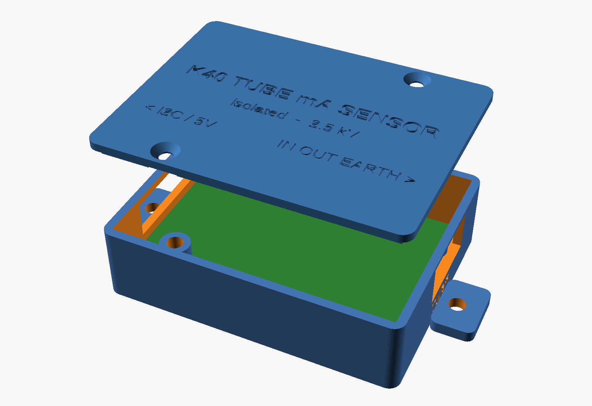

# Printed enclosure for the current sensor

Two parts, no supports. Outside size is 76 × 58 × 22 mm, plus a mounting ear at each end.

| File | Print |
|---|---|
| [`base.stl`](base.stl) | Floor down |
| [`lid.stl`](lid.stl) | Already flipped: top face on the bed |

PETG or ABS, 0.2 mm layers, 3 walls, 20% infill. Avoid PLA if the box will sit near the PSU,
because it softens above about 55 °C.

## Assembly

1. **Press in 6 × M3 heat-set inserts** (4.0 mm hole, 4–5 mm long, e.g. Ruthex or CNC Kitchen M3)
   with a soldering iron at about 220–250 °C: 4 in the PCB standoffs, 2 in the tall lid posts. Push
   them flush, without going deeper.
2. Solder the screw terminals, with the wire openings facing the board ends.
3. Screw the PCB down with **4 × M3 × 6** screws, nylon preferred. Panel side (J1/J2) goes to the
   end marked **PANEL**, tube side (J3) to the end marked **TUBE**.
4. Wire through the end slots. Do this with the lid off: the terminal screws are on top.
5. Fit the lid with **2 × M3 × 6** screws. Each lid screw sits over one half of the board, well away
   from the isolation gap, so a metal screw never bridges the two sides.
6. Mount with M4 screws through the two end ears on an insulated surface, away from the HV lead.

No inserts? Set `INSERTS = false` in [`enclosure.scad`](enclosure.scad) for self-tapping holes, then
export again (OpenSCAD: **F6**, then **File → Export → STL**, with `part` set to `"base"` or `"lid"`).
If your terminals are taller than 11 mm, raise `term_h`.
