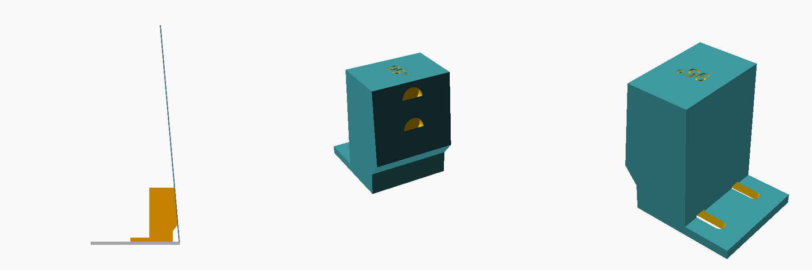

# Magnetic lid stop

*Left: side view, with the lid resting on the stop at 95°. Middle: the angled contact face with two
magnet pockets. Right: the back, with the adjusting slots.*

A printed wedge that sits on the top panel just behind the lid's hinge. When you open the lid, its
outer face leans back flat against the wedge, and two magnets hold the steel lid in place. The lid
lands at the same angle every time, which is what a lid-mounted LightBurn camera needs to stay
calibrated.

- **Nothing in the cutting area:** it sits on the outside of the machine, behind the lid.
- **Stops just past vertical** (95°), so the lid's weight leans it onto the stop, and the magnets
  stop it bouncing forward.
- **No measuring:** slide it forward or back in its slots until the lid sits where you want it,
  then fix it down. 1 mm of slide is about 1° of lid angle.

## Print

[`lid-stop.stl`](lid-stop.stl): print **two**, base down. PETG, 0.2 mm layers, 4 walls, 25% infill,
no supports. The angle is printed on top.

**Per stop:**
- 2 × **10 × 3 mm disc magnets** (N52), glued into the pockets with CA glue. They sit 0.4 mm below
  the face, so the lid rests on the plastic and the magnets don't get chipped.
- A strip of **3M VHB tape** (e.g. 5952) under the base, *or* 2 × M4 screws through the slots.

Make the magnet polarity the same in all four pockets. The steel lid doesn't care about polarity,
but matching magnets are easier to handle.

## Fit

1. Open the lid as far as it goes, and decide where the stops go: one beside each hinge, on the
   panel behind the lid, **clear of the hinge leaves**.
2. Put each stop on the panel with its face toward the lid, and slide it toward the hinge until the
   lid rests against both faces at the angle you want. The bottom of the face is cut back to clear
   the hinge knuckle.
3. Check that the lid sits flat on both faces, close it and open it a few times, and check that it
   always lands in the same place.
4. Mark the positions, then fix the stops down with VHB tape (clean the paint with isopropyl
   alcohol first) or with screws through the slots.

**Don't drill into the cover over the laser tube.** The tube and its high-voltage lead are right
under it. Use VHB tape there; screws are only for a panel with nothing under it.

## Changing the design

[`lid-stop.scad`](lid-stop.scad) is parametric. `stop_angle` sets the face angle (keep it above 90),
and `H`, `W`, `D` set the size. If your panel behind the hinge sits well above or below the hinge
pin, adjust `relief` so the face clears the hinge.

License: CERN-OHL-P-2.0, like the rest of the hardware in this repo.
